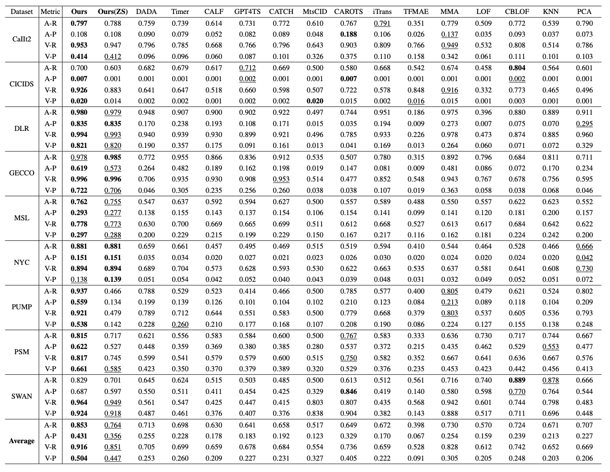

#  VAN-AD: Visual Masked Autoencoder with Normalizing Flow For Time Series Anomaly Detection

**Official PyTorch implementation of the paper: VAN-AD: Visual Masked Autoencoder with Normalizing Flow For Time Series Anomaly Detection.**

If **VAN-AD** helps your research, please consider giving us a ⭐ star!

[](https://www.python.org/)  [](https://pytorch.org/)

## 💡 Overview
**VAN-AD**, a novel framework that adapts a pre-trained visual Masked Autoencoder (MAE) to TSAD. To alleviate the over-generalization issue of MAE, we design an **Adaptive Distribution Modulation Module (ADMM)**, which recalibrates MAE reconstructions based on local window statistics to preserve and amplify reconstruction discrepancies associated with anomalous patterns. To overcome the limitation of local perception, we further develop a **Normalizing Flow Module (NFM)**, which models the global distribution of normal patterns and estimates the probability density of each window, thereby providing a complementary global anomaly signal.
<div style="text-align: center;">
    
</div>


## 🚀 Getting Started

### Installation

Ensure you have a Python 3.8+ environment ready. Install the necessary dependencies via:

```
pip install -r requirements.txt
```

### Data preparation
Download MSL/PSM datasets via [OneDrive](https://drive.google.com/file/d/1fAbKk2keJpp2tavkJlbtr5xjG8wI7ekf/view) and store them under the /data path, for example: /data/PSM
Regarding the remaining datasets, we follow the TAB data processing pipeline. Download the dataset from TAB (https://github.com/decisionintelligence/TAB) and store it under the data folder, for example, data/tab.

### Train & Evaluation

- **Model Definition**: Explore the core logic in [here](./van-ad/vanad_model.py).
- **Reproduction**: Run the provided scripts to replicate our results. For instance, to test on the PSM dataset:

```shell
sh ./scripts/PSM.sh
```


## 📊 Experimental Results

Extensive experiments on nine real-world datasets demonstrate that VAN-AD achieves state-of-the-art performance. We show the main results of all the nine real-world datasets:

<div align="center">

</div>


## 🙏 Acknowledgements
We acknowledge the following open-source projects for their outstanding contributions to the field:

- TAB: Unified Benchmarking of Time Series Anomaly Detection Methods（https://github.com/decisionintelligence/TAB）

## ✉️ Contact

If you have any questions or suggestions, feel free to contact:
- [PengYu Chen]  (penychen@bupt.edu.cn)
- [Shang Wan]  (wangshang@bupt.cn)

- Or describe it in Issues.

