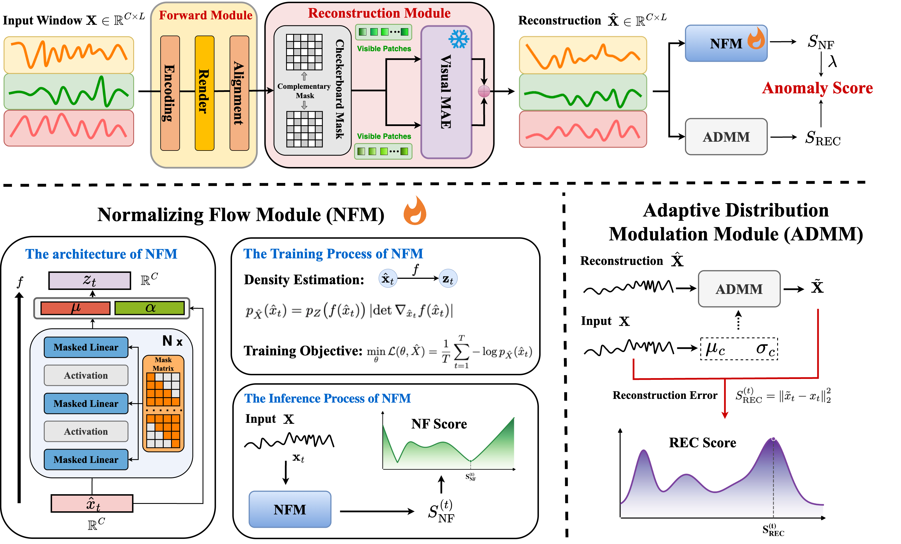

<h1 align="center">
  
  VAN-AD: Visual Masked Autoencoder with Normalizing Flow for Time Series Anomaly Detection
</h1>

<p align="center">
  <strong>Official PyTorch implementation of our IEEE Transactions on Dependable and Secure Computing (TDSC) paper.</strong>
</p>

<p align="center">
  <a href="https://www.python.org/">
    
  </a>
  <a href="https://pytorch.org/">
    
  </a>
  <a href="https://arxiv.org/abs/2603.26842">
    
  </a>
  <a href="https://doi.org/10.1109/TDSC.2026.3732446">
    
  </a>
  
</p>

<p align="center">
  If <strong>VAN-AD</strong> helps your research, please consider giving us a ⭐ star!
</p>

## 💡 Overview

**VAN-AD** is a novel framework that adapts a pre-trained visual **Masked Autoencoder (MAE)** to time series anomaly detection (TSAD).

To alleviate the **over-generalization** issue of MAE, we introduce an **Adaptive Distribution Modulation Module (ADMM)**, a training-free post-processing module that recalibrates MAE reconstructions using local window statistics, thereby amplifying reconstruction discrepancies associated with anomalous patterns.

To address the limitation of **local perception**, we further develop a **Normalizing Flow Module (NFM)**, which models the global probability distribution of normal patterns and estimates the likelihood of each input window, providing a complementary global anomaly signal.

VAN-AD combines reconstruction-based anomaly evidence with global distribution modeling and achieves strong performance across nine real-world TSAD benchmarks.

<div align="center">
  
</div>

## 📰 Publication

Our paper has been accepted by **IEEE Transactions on Dependable and Secure Computing (TDSC)**.

- **Title:** VAN-AD: Visual Masked Autoencoder with Normalizing Flow for Time Series Anomaly Detection
- **Journal:** IEEE Transactions on Dependable and Secure Computing
- **DOI:** [10.1109/TDSC.2026.3732446](https://doi.org/10.1109/TDSC.2026.3732446)
- **arXiv:** [2603.26842](https://arxiv.org/abs/2603.26842)

If you find this work useful, please consider citing:

```bibtex
@article{chen2026vanad,
  title={VAN-AD: Visual Masked Autoencoder with Normalizing Flow for Time Series Anomaly Detection},
  author={Chen, PengYu and Wang, Shang and Shi, Xiaohou and Chang, Yuan and Sun, Yan and Das, Sajal K.},
  journal={IEEE Transactions on Dependable and Secure Computing},
  year={2026},
  doi={10.1109/TDSC.2026.3732446}
}
```

## 🚀 Getting Started

### Installation

We recommend Python 3.8 or later.

Install the required dependencies with:

```bash
pip install -r requirements.txt
```

### Data Preparation

1. Sign in to Feishu and download the [VAN-AD dataset archive](https://my.feishu.cn/file/ZC7YbC2dTosBvdxGyzxcenwInkf?from=from_copylink).
2. Place the downloaded archive in the project root directory.
3. Extract the archive directly in the project root.

The training and evaluation scripts expect the datasets to be organized under:

```text
data/
```

### Training & Evaluation

- **Model Definition:** See [`vanad/vanad_model.py`](./vanad/vanad_model.py) for the core implementation.
- **Reproduction:** Run the provided scripts to reproduce the experimental results.

For example, to run VAN-AD on the PSM dataset:

```bash
sh ./scripts/PSM.sh
```

## 📊 Experimental Results

We evaluate VAN-AD on nine real-world time series anomaly detection datasets. Experimental results demonstrate that VAN-AD consistently achieves competitive or state-of-the-art performance across multiple evaluation metrics.

<div align="center">
  
</div>

## 🙏 Acknowledgements

We thank the following open-source project for its valuable contribution to time series anomaly detection benchmarking:

- [TAB: Unified Benchmarking of Time Series Anomaly Detection Methods](https://github.com/decisionintelligence/TAB)

## ✉️ Contact

If you have any questions or suggestions, please feel free to contact:

- **PengYu Chen:** penychen@bupt.edu.cn
- **Shang Wang:** wangshang@bupt.cn

You are also welcome to open an issue in this repository.